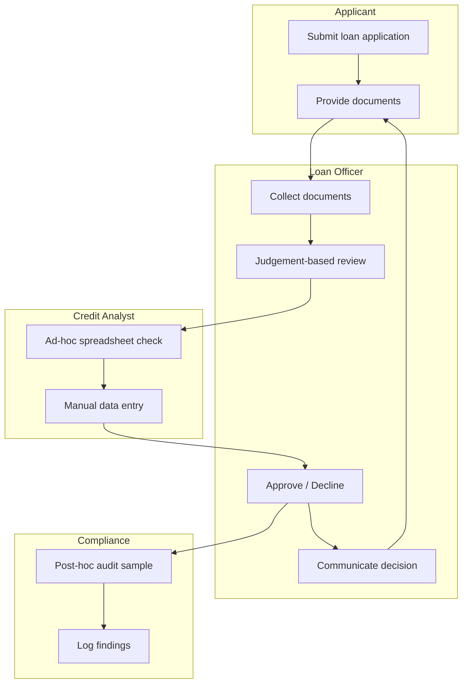
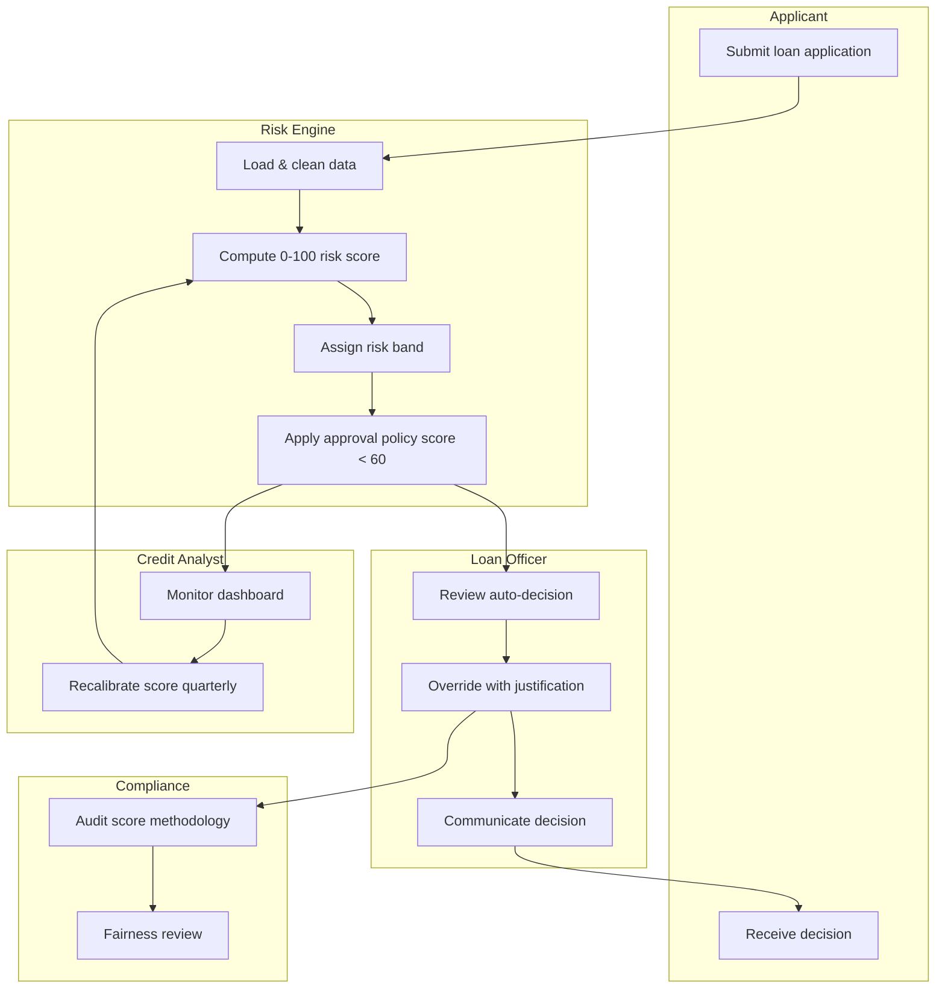

# Process Maps — Credit Risk Assessment

This document describes the **AS-IS** (current, manual) and **TO-BE** (data-driven) loan approval processes for the retail bank, using Mermaid flowcharts with one swimlane (`subgraph`) per actor. A gap analysis table follows.

## AS-IS Process (current manual approval)

## TO-BE Process (data-driven risk segmentation)

## Gap Analysis

| Area | AS-IS | TO-BE | Gap | Action |
|---|---|---|---|---|
| Decision basis | Judgement | Transparent 0–100 score | No standard score | Deploy risk score |
| Consistency | Officer-dependent | Rule-based policy | Inconsistent approvals | Approval policy (score < 60) |
| Risk visibility | Ad-hoc spreadsheets | Dashboard | No portfolio view | Build dashboard |
| Auditability | Sample audit | Documented methodology | Limited traceability | BRD + notebook |
| Monitoring | None | Quarterly recalibration | No feedback loop | Monitoring process |
| Fairness | Informal | Formal review | No structured check | Compliance review |
| Data quality | Manual entry | Automated cleaning | Error-prone | Validation steps |
| Speed | Manual review | Auto-decision + review | Slow turnaround | Risk engine |
